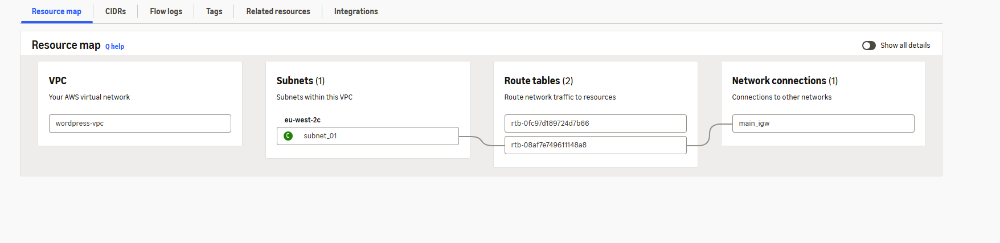
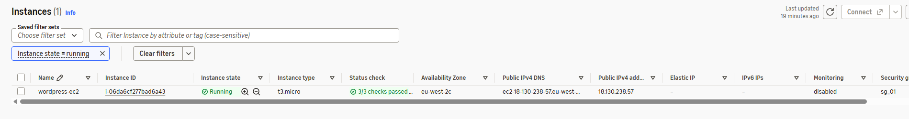
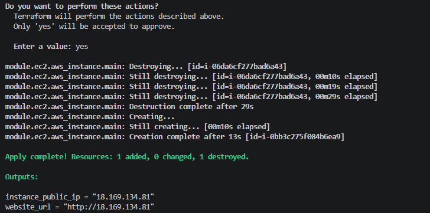
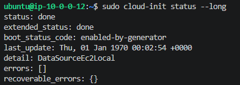
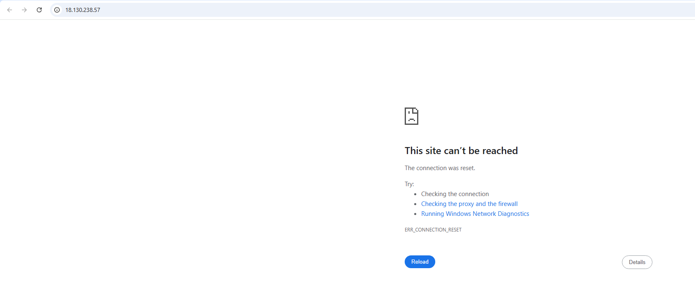
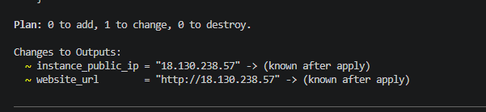

# WordPress Deployment on AWS with Terraform

## Overview

Deployed WordPress on AWS using **Terraform** with reusable modules for networking, security, and compute.

EC2 user data automates the installation of Apache, PHP, MariaDB, and WordPress through cloud-init.

## Tech Stack

**AWS** | **Terraform** | **Ubuntu** | **Bash** | **Apache** | **PHP** | **MariaDB** | **WordPress**

## Infrastructure

- **VPC:** `10.0.0.0/26`
- **Public Subnet:** `10.0.0.0/27`
- **EC2:** `t3.micro` running Ubuntu
- **Networking:** Internet Gateway and public route table
- **Security:** HTTP (80) publicly accessible; SSH (22) restricted to my IP
- **Region:** London (`eu-west-2`)

### VPC Resource Map



## Deployment

### 1. Terraform Plan

Validated the configuration and generated an execution plan for 10 AWS resources.


### 2. EC2 Provisioning

Terraform provisioned the AWS infrastructure and launched an EC2 instance.



### 3. Successful Deployment

After correcting the configuration, Terraform replaced the EC2 instance with one configured to execute the WordPress installation script.



### 4. Verification

Confirmed cloud-init completed without errors and the WordPress installation page was accessible.




## Troubleshooting

The initial EC2 deployment succeeded, but WordPress was inaccessible.



**Cause:** The `user_data` configuration hadn't been saved in VS Code before deployment, so the instance launched without the installation script.

**Resolution:** Saved the configuration and added:

```hcl
user_data_replace_on_change = true
```

Terraform initially proposed updating the instance rather than replacing it.



After enabling replacement, Terraform recreated the EC2 instance and cloud-init successfully installed WordPress.

**Lesson learned:** Successful infrastructure provisioning doesn't guarantee successful application deployment.
