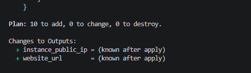
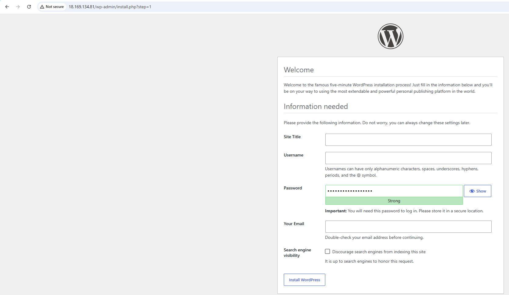

# WordPress Deployment on AWS with Terraform

## Overview

Deployed a WordPress application on AWS using **Terraform Infrastructure as Code (IaC)**.

The project uses reusable Terraform modules to provision AWS networking, security and compute resources. A Bash user-data script automates the installation of Apache, PHP, MariaDB and WordPress.

## Technologies

- **Cloud:** AWS (VPC, EC2, Security Groups, Internet Gateway)
- **IaC:** Terraform
- **OS & Scripting:** Ubuntu Linux, Bash, cloud-init
- **Web Stack:** Apache, PHP, MariaDB, WordPress

## Architecture & Networking

The infrastructure was deployed in the **London region (`eu-west-2`)**.

- **VPC:** `10.0.0.0/26` – isolated network for the application.
- **Public Subnet:** `10.0.0.0/27` – hosts the EC2 instance.
- **Internet Gateway:** Provides internet connectivity for the VPC.
- **Route Table:** Routes `0.0.0.0/0` traffic through the Internet Gateway.
- **Security Group:** Allows HTTP (80) publicly and SSH (22) from my IP only.
- **EC2:** `t3.micro` Ubuntu instance hosting WordPress.

The EC2 instance has a public IP address, allowing users to access WordPress over HTTP.

### VPC Resource Map

## Terraform Modules

The infrastructure is organised into three reusable modules:

| Module | Responsibility |
|--------|----------------|
| `vpc` | Creates the VPC, subnet, Internet Gateway and routing |
| `sg` | Configures inbound and outbound security rules |
| `ec2` | Provisions the Ubuntu instance and executes user data |

Variables are used to configure resources, while outputs expose the instance's public IP and website URL.

## Deployment & Automation

### 1. Infrastructure Provisioning

Terraform was used to initialise, validate and plan the infrastructure before deployment.

The initial execution plan identified **10 AWS resources** to create.

### 2. EC2 Deployment

Terraform provisioned the networking resources, security group and EC2 instance.

### 3. WordPress Automation

The EC2 instance uses a Bash user-data script executed by **cloud-init** during its initial boot.

The script automatically:

1. Installs Apache, PHP and MariaDB.
2. Creates the WordPress database and database user.
3. Downloads and configures WordPress.
4. Configures file permissions and the web server.

This removes the need to manually install the application after launching the instance.

## Verification

After resolving an initial configuration issue, Terraform successfully replaced the EC2 instance.

Verified that cloud-init completed without errors.

The WordPress installation page was then accessible through the EC2 instance's public IP.

## Troubleshooting & Lessons Learned

### Issue: WordPress Was Inaccessible

The initial infrastructure deployment succeeded, but the browser returned a connection error.

**Investigation:**

- Connected to the instance using SSH.
- Checked whether Apache was installed and running.
- Inspected cloud-init and the EC2 user-data configuration.
- Discovered that the `user_data` configuration hadn't been saved in VS Code before deployment.

**Resolution:**

Saved the Terraform configuration and enabled instance replacement when user data changes:

    user_data_replace_on_change = true

Terraform initially proposed an in-place update before replacement was enabled.

After applying the corrected configuration, Terraform replaced the EC2 instance. Cloud-init executed the installation script and WordPress became accessible.

### Key Takeaways

- Gained practical experience organising AWS infrastructure into Terraform modules.
- Understood how Terraform provisioning and cloud-init configuration work together.
- Practised troubleshooting EC2 instances using SSH and Linux services.
- Learned that successful infrastructure provisioning doesn't necessarily guarantee a working application.
